# 实验2 串口通信实验

> 平台：STM32F103C8T6 最小系统核心板（Blue Pill）+ CH340 USB/TTL 串口模块
> 环境：STM32CubeMX 6.16.1 + Keil MDK 5 + ST-Link V2 + 串口助手（纸飞机调试助手）
> 内容：串口协议与 RS-232 / RS-485 标准、两机串口传文件、USART1 的轮询 / 中断 / DMA 三种收发方式、Keil 软件仿真测量实际波特率

---

## 一、实验目的

1. 理解串口异步通信的数据帧格式与波特率，会估算"文件大小—波特率—传输时间"三者的关系。
2. 掌握 RS-232、RS-485 与 TTL 电平的区别，理解 CH340 模块"USB ↔ 串口"的转换原理。
3. 会用两台电脑 + 两个 CH340 模块建立串口连接并传输大文件，能解释共地（GND）的必要性。
4. 会用 CubeMX 配置 USART1（115200-8-N-1），用 HAL 库实现轮询收发与 `#` 暂停 / `*` 恢复（任务一）。
5. 掌握串口中断与 DMA 编程，完成中断方式收发与 DMA 连续发送（任务二）。
6. 会用 Keil 软件仿真的逻辑分析仪观察串口时序、分析时序状态并计算实际波特率（任务三）。

## 二、实验器材与软件

硬件：STM32F103C8T6 最小系统板、ST-Link V2 下载器、CH340 USB/TTL 串口模块 2 个、杜邦线若干、Windows 11 笔记本电脑 2 台。

软件：STM32CubeMX 6.16.1（固件包 STM32Cube FW_F1 V1.8.7）、Keil MDK 5、串口助手（纸飞机调试助手 / SSCOM）、CH340 VCP 驱动。

---

## 三、基础1　串口协议与 RS-232 / RS-485 标准

### 3.1 串口协议与数据帧

串口是**异步串行**通信：收发双方没有共享时钟线，靠事先约定好的**波特率**和帧的起始/停止位同步。STM32 的 USART1 工作在全双工方式，TXD 发送、RXD 接收各用一根线。

以本实验使用的 8-N-1（8 位数据、无校验、1 位停止位）为例，一帧格式如下：

```text
空闲(高)  起始位   D0   D1   D2   D3   D4   D5   D6   D7   停止位  空闲(高)
 ────────┐      ┌────┬────┬────┬────┬────┬────┬────┬────┐      ┌────────
         └──────┘    （数据位 LSB 先发，低电平/高电平表示 0/1）└──────┘
         ↑1位      ←────────── 8 位数据 ──────────→         ↑1位
```

不发送时空闲为高电平；起始位是 1 位低电平；8 位数据**低位先发**（如 `h` = 0x68 = 0b0110 1000，线上顺序为 0,0,0,1,0,1,1,0）；停止位是 1 位高电平。所以 **8-N-1 时一帧共 10 位**。

波特率表示每秒传输的位数。115200 bps 时，1 位 = 8.68 µs，1 字节（10 位）≈ 86.8 µs，理论吞吐量 11520 B/s。收发双方波特率必须一致，否则采样点会逐渐偏移造成误码，工程上要求偏差控制在 2%~3% 以内。

单片机引脚直接输出的是 **TTL 电平**：逻辑 1 为 2.4 V~VCC，逻辑 0 为 0~0.4 V。噪声容限只有 0.4 V，且是单端信号，**必须共地**，只适合板内或 1 m 以内的短距离连接。

### 3.2 RS-232 标准

RS-232 采用**负逻辑、单端**信号：逻辑 1 是 −3 V ~ −15 V，逻辑 0 是 +3 V ~ +15 V，−3 V ~ +3 V 为无效过渡区。摆幅达 ±12 V 左右，噪声容限约 ±3 V，抗干扰能力强于 TTL，但仍必须共地。

接口常用 DB9，实际多为三线制：只用 2-RXD、3-TXD、5-GND，两端 RXD 与 TXD **交叉连接**。规范规定距离约 15 m、速率不超过 20 kbps。

MCU 的串口不能直接接 RS-232：一来电平与极性都不兼容，二来 ±12 V 超过 MCU 引脚的绝对最大额定值会损坏器件，必须经 **MAX232 / SP3232** 这类电平转换芯片（内部电荷泵产生正负电压）。

### 3.3 RS-485 标准

RS-485 用一对线 A、B 传输**差分信号**，接收方判断的是两线电压差 VA − VB：≥ +200 mV 为逻辑 1，≤ −200 mV 为逻辑 0，共模输入范围 −7 V ~ +12 V。因为是差分判决，两根线上同时叠加的共模干扰会被抵消，所以抗干扰能力远强于 TTL 和 RS-232，也容忍两端地电位存在差异。

总线可接成半双工两线或全双工四线，一条总线标准驱动能力为 32 个单位负载（用 1/8 负载收发器可扩展到 256 点），并在两个物理末端各接一只 120 Ω 终端电阻以吸收反射。速率与距离成反比：100 kbps 可传 1200 m，1 Mbps 约 120 m，10 Mbps 只剩约 12 m。

### 3.4 三者的区别

一句话概括：**TTL** 是 0/3.3 V 正逻辑的单端信号，只能短距离并必须共地；**RS-232** 是 ±3~±15 V 负逻辑的单端信号，摆幅和容限更大但仍须共地，距离不超过 15 m；**RS-485** 是差分信号，靠电压差判决，距离可达 1200 m、可挂多机、抗干扰最强，并允许地电位差。因此 TTL 与 RS-232 之间要用电平转换芯片（MAX232）衔接，RS-485 则需要 MAX485 类收发器并配合 DE/RE 做收发方向控制。

### 3.5 CH340 模块的工作原理

现代电脑已无串口，而 MCU 输出的是 TTL 电平，所以需要桥接芯片把 USB 虚拟成串口。CH340 内部由三部分组成：**USB 收发器与串行接口引擎（SIE）**完成 USB 全速 12 Mbps 的物理层与协议处理，**端点缓冲区（FIFO）**暂存数据，**UART 控制器**按设定的波特率与数据格式串行收发（支持 5~8 位数据、1/1.5/2 位停止位、奇偶/无校验）。安装 VCP 驱动后，设备管理器出现 `USB-SERIAL CH340 (COMx)`，软件按普通串口读写，数据流为：

```text
串口助手 → Windows 串口驱动 → USB 主机 → CH340(USB收发器/SIE → FIFO → UART控制器) → TXD(TTL 串口帧) → 目标设备
```

两种模块要分清：**USB 转 TTL 模块**只有 CH340，输出 TTL 电平，引出 TXD、RXD、GND、VCC；**USB 转 RS-232 模块**则是在 CH340 之后再接一颗 MAX3232/SP3232，把 TTL 电平转换成 RS-232 电平从 DB9 输出——题目所说的"USB/TTL 转 RS232"就是后者，即"协议转换（CH340）+ 电平转换（MAX3232）"两级串联。

使用要点：TXD 与 RXD 必须交叉，GND 必须相连；与 3.3 V 的 STM32 连接时模块应设为 3.3 V 电平；驱动未装时设备管理器会出现带感叹号的未知设备；波特率过高或线太长会出现偶发乱码。

### 3.6 两机互联的接线方式

```text
   笔记本 A                          笔记本 B
 ┌──────────┐                     ┌──────────┐
 │  USB口   │                     │  USB口   │
 └────┬─────┘                     └─────┬────┘
 ┌────┴─────┐                     ┌─────┴────┐
 │ 模块 A   │  TXD ───────────────→ RXD      │
 │ (CH340)  │  RXD ←─────────────── TXD      │
 │          │  GND ───────────────  GND      │
 └──────────┘                     └──────────┘
        （VCC 不互连，各自由 USB 供电）
```

原则是"**交叉 + 共地**"：A 的 TXD 接 B 的 RXD，A 的 RXD 接 B 的 TXD，GND 相连；VCC 不互连。

---

## 四、基础2　串口传输文件实验

### 4.1 器材与连接

两台笔记本各插一个 CH340 模块，用杜邦线按 3.6 节的"交叉 + 共地"方式连接（GND 相连，VCC 不接）

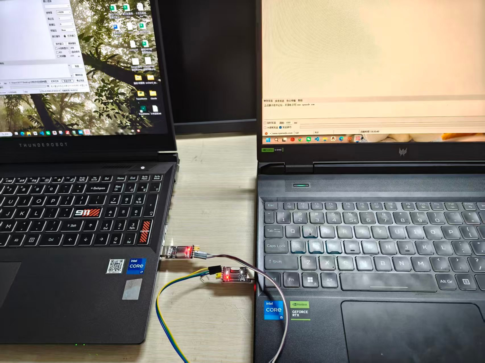

*图 1　两机互联接线实物：TXD→RXD、RXD→TXD 交叉，GND 相连，VCC 不接*

### 4.2 软件设置与操作步骤

两台电脑的串口助手（本例使用 **XCOM V2.6**，SSCOM 操作类似）设为完全相同的参数：波特率 115200、数据位 8、停止位 1、无校验、无流控，串口选各自设备管理器中查到的 CH340 虚拟 COM 口。

1. 两台电脑分别插上模块并安装 CH340 驱动；
2. 接线（先接 GND，再接 TXD/RXD）；
3. 两端打开串口，先互发一个字符，确认收发都正常；
4. 接收端勾选"自动保存"（或用"协议传输"的接收模式），把收到的数据保存成文件；
5. 发送端点"打开文件"选中待传的大文件（图片/视频/压缩包），再点"发送文件"开始发送；
6. 用秒表记录传输时间，传输结束后比较源文件与接收文件的大小（或哈希）以校验完整性。

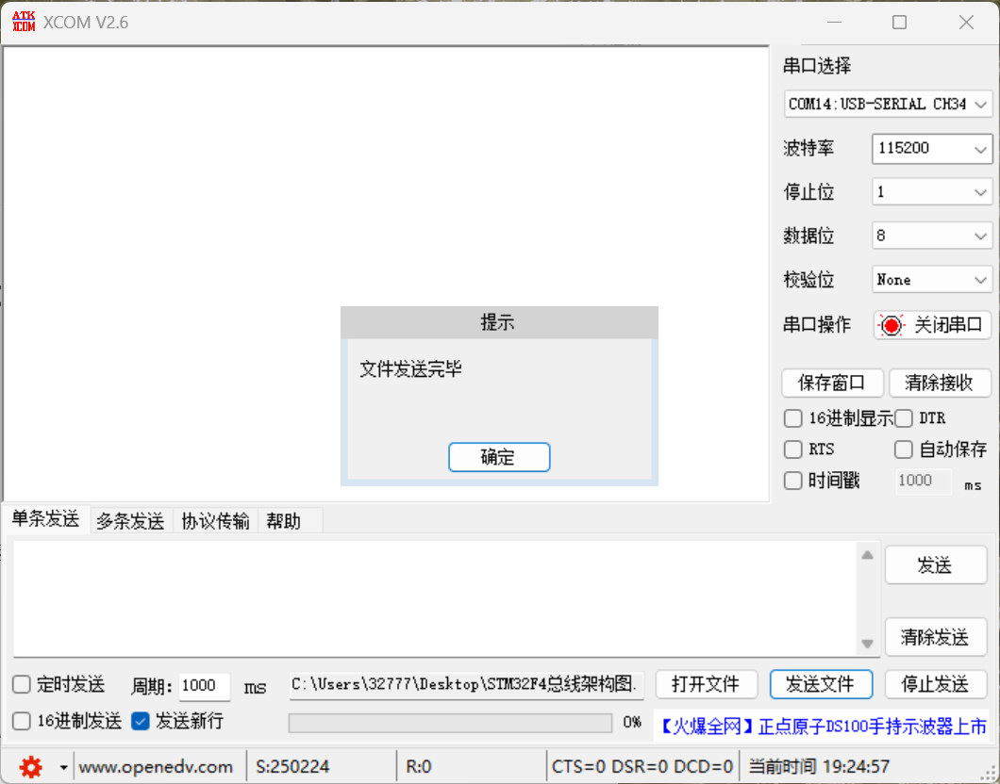

*图 2　XCOM 在两台电脑之间传输文件（COM14、115200，发送完毕时已发出 250 224 字节）*

### 4.3 文件大小、波特率与传输时间的关系

8-N-1 时每字节 10 位，所以理论传输时间只取决于文件大小与波特率：

```text
理论传输时间 T = 文件字节数 × 10 ÷ 波特率
实际平均速率   = 文件字节数 ÷ 实测时间
```

即时间与文件大小成正比、与波特率成反比。例如 1 MB 文件在 115200 bps 下理论约 91 s，在 9600 bps 下要约 18 分钟；100 KB 在 115200 bps 下约 8.9 s。

实际时间一般比理论值长 5%~20%，来源是串口助手的分包间隔、USB 与串口驱动的缓冲调度、磁盘写入及界面刷新等开销；另外串口助手传文件是"裸发 + 分包"，没有差错重传，误码会直接损坏文件，必须用文件大小/哈希校验完整性。

### 4.4 实验结果与对比

以一张 PNG 图片（`STM32F4总线架构图.png`，**250 224 字节**，约 245 KB）为例，在 115200 bps、8-N-1 下进行传输：

```text
理论传输时间 T = 250 224 × 10 ÷ 115 200 ≈ 21.72 s
实测传输时间 ≈ 22 s
相对偏差 = (22 − 21.72) ÷ 21.72 ≈ +1.3 %
实测平均速率 = 250 224 ÷ 22 ≈ 11 374 B/s（理论 11 520 B/s）
```

实测时间与理论值只差 1.3%，说明**串口传输文件的时间基本由"文件大小 ÷ 波特率"决定**。

### 4.5 只接 TX-RX 两根线能否正常工作

结论：**不接电源线（VCC）可以正常传；不接 GND 地线不能可靠工作**，通常完全收不到数据或全是乱码。

不接 VCC 可以，是因为两个模块各自由 USB 供电，信号电平由各自的电路产生，不需要对方供电；互接 VCC 反而可能因两路电源电压不一致而倒灌。

不接 GND 不行，是因为串口是**单端信号**，逻辑电平是"信号线相对于本机 GND"的电压，收发双方必须有**共同的 0 V 参考**。两台笔记本由不同适配器供电时，地之间存在由漏电流引起的浮地电位差（可达几百 mV 甚至几伏），它会叠加到信号上，使高低电平被判错；同时缺少地回路，信号电流没有回流路径，波形也会畸变。TTL 的噪声容限只有 0.4 V（RS-232 约 ±3 V），所以更容易失效。

需要注意：如果两台设备由**同一台电脑或同一个 USB HUB** 供电，它们已通过 USB 共地，此时不接 GND 线也能通——可见真正的要求是"双方电平参考一致"，而不是"必须接那根线"。

验证方法：接好 GND 传文件（正常）→ 只拔掉 GND 再传（乱码或无数据）→ 接回 GND 恢复；再把 VCC 接上（GND 正常）传输同样正常。三种结果一并记入 4.4。

---

## 五、任务一　USART1 轮询方式收发

### 5.1 用 CubeMX 新建工程并配置 USART1

打开 STM32CubeMX，File → New Project，在 Part Number 中搜索并选中 **STM32F103C8Tx**，右侧出现芯片引脚图后建立工程。

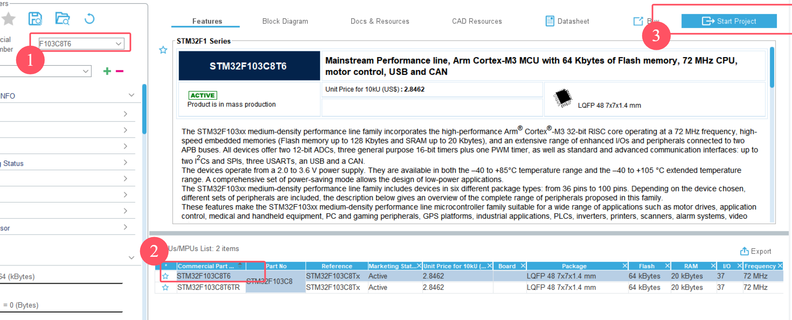

*图 3　新建工程并选择 STM32F103C8Tx*

System Core → SYS，把 Debug 选为 **Serial Wire**，保留 PA13/PA14 作为 SWD 调试口，供 ST-Link 下载与仿真使用。

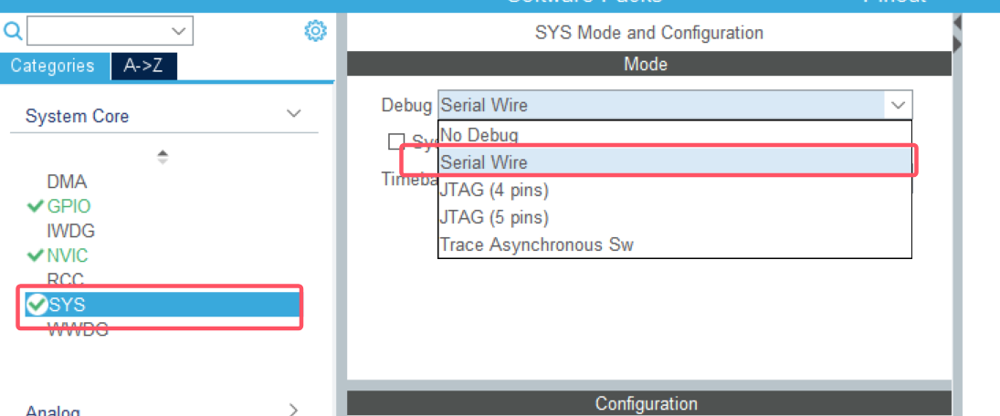

*图 4　SYS 的 Debug 选为 Serial Wire*

System Core → RCC，High Speed Clock (HSE) 选 **Crystal/Ceramic Resonator**，使用板上的 8 MHz 外部晶振。外部晶振比内部 HSI 精度高，串口波特率更准确。

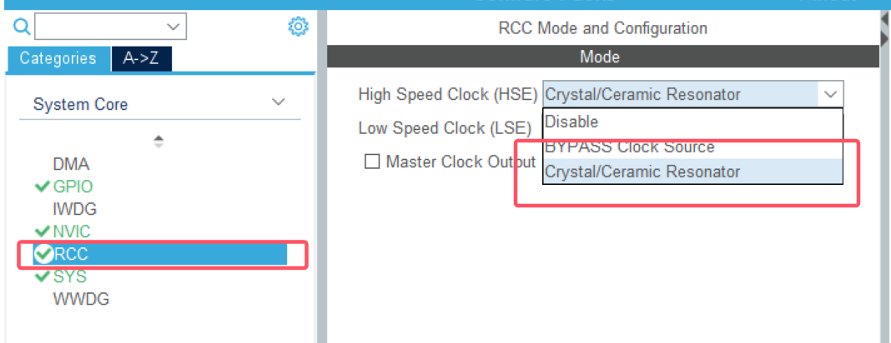

*图 5　RCC 的 HSE 选为 Crystal/Ceramic Resonator*

切到 Clock Configuration 页，选择HSE，然后打开PLLCLK，最后直接把HCLK设置为72MHz，这样时钟树就配置好了。

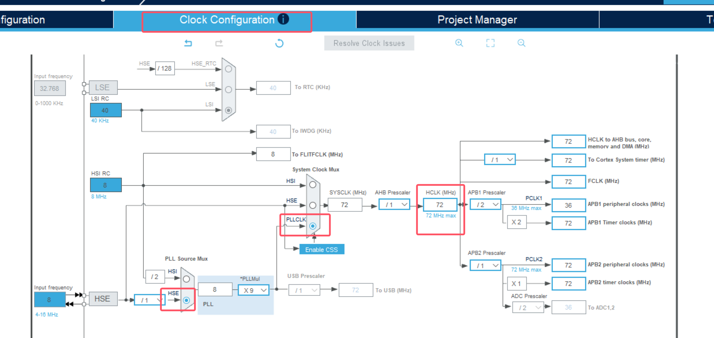

*图 6　时钟树配置为 72 MHz*

Connectivity → USART1：Mode 选 **Asynchronous**，Parameter Settings 中 Baud Rate = **115200 Bits/s**、Word Length = **8 Bits**、Parity = **None**、Stop Bits = **1**，即 115200-8-N-1。此时引脚图上 PA9 自动分配为 USART1_TX、PA10 为 USART1_RX。

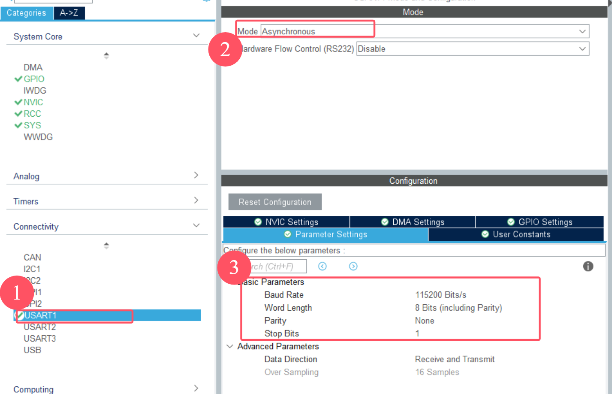

*图 7　USART1 配置为异步方式、115200-8-N-1*

最后在 Project Manager 页把 Project Name 设为 `task1`、Project Location 指向 `expr2` 目录、Toolchain/IDE 选 **MDK-ARM**；Code Generator 页勾选"只复制必要的库文件"和"外设按 .c/.h 成对生成"（这样每个外设会生成独立的 usart.c/usart.h，便于阅读），再点 GENERATE CODE 生成工程。

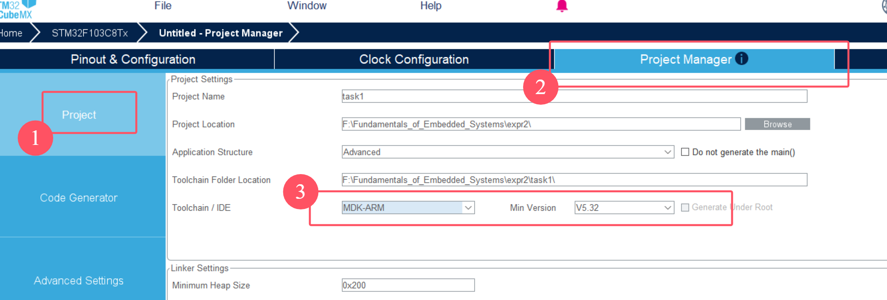

*图 8　Project Manager 中的工程名、路径与工具链*

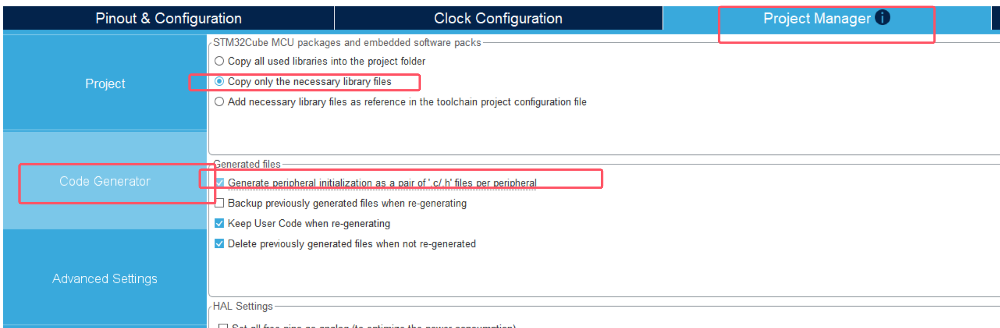

*图 9　Code Generator 设置：只复制必要库文件、外设按 c/h 成对生成*

### 5.2 在 Keil 中整理工程结构

为更好的管理，修改，和阅读工程，所以在工程根目录下新建 `bsp` 文件夹，并在其中新建两个空文件 `my_main.c`、`my_main.h`，这两个文件就用来放我们新加的代码。

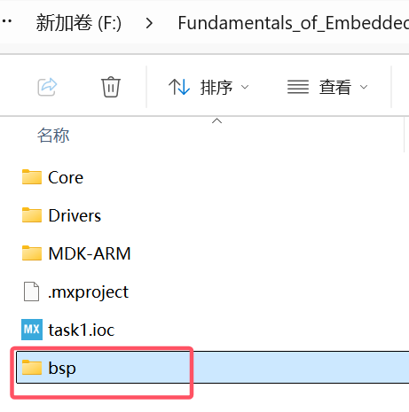

*图 10　工程根目录下新建 bsp 文件夹*

用 Keil 打开 `MDK-ARM\task1.uvprojx`，点工具栏 Manage Project Items 新建分组 **bsp**；再点 Options for Target → C/C++，把 `..\bsp` 加入包含路径（Include Paths），使 `my_main.h` 能被正确找到。

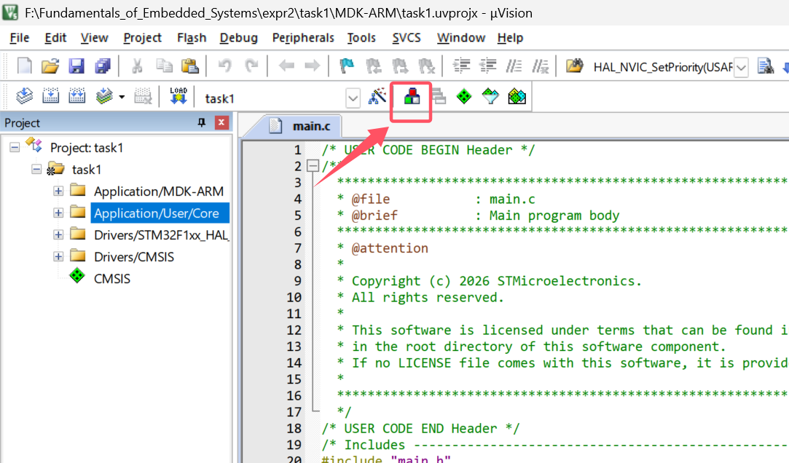

*图 11　用 Keil 打开生成的工程*

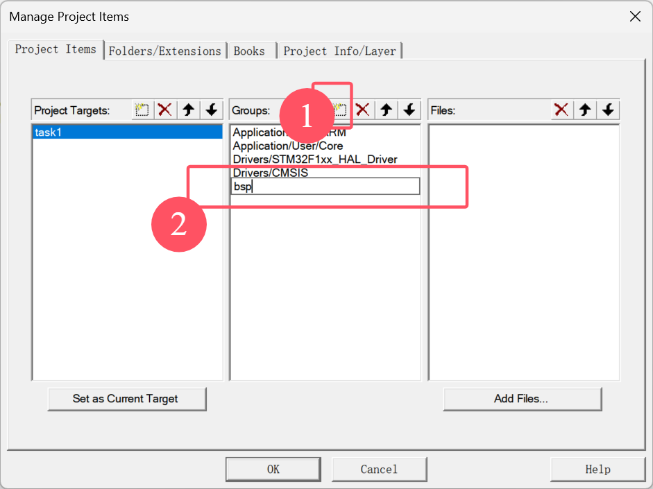

*图 12　Manage Project Items 中新建 bsp 分组*

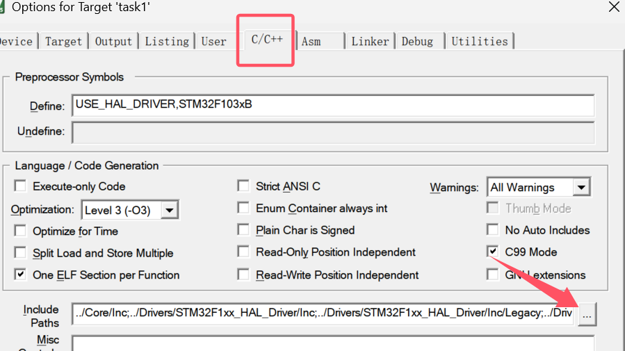

*图 13　Options for Target 的 C/C++ 选项卡*

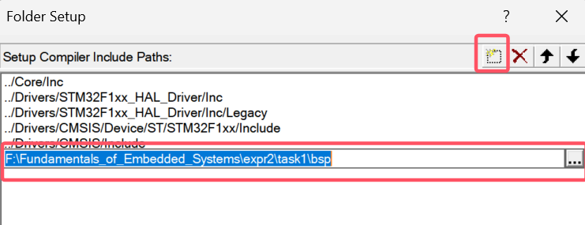

*图 14　包含路径中加入 ..\bsp*

### 5.3 编写 my_main.c 与 my_main.h

在 `bsp` 文件夹中新建 `my_main.h` 和 `my_main.c`，把 `my_main.c` 加入 Keil 的 bsp 分组，再在 `main.c` 的 USER CODE 区域调用封装好的 `setup()` 与 `loop()`。

**（1）my_main.h**

```c
#ifndef __MY_MAIN_H
#define __MY_MAIN_H

#include "main.h"
#include "usart.h"
#include "gpio.h"

#include "stdio.h"
#include "string.h"

void setup(void);
void loop(void);

#endif
```

**（2）my_main.c（任务一(1)：轮询方式连续发送）**

```c
#include "my_main.h"


char uart_tx_data[30];  // 用于存放要发送的数据

// 初始化函数
void setup(void)
{

}

// 这个函数用于放在主循环里面
void loop(void)
{
	sprintf(uart_tx_data,"hello windows!\r\n");
	HAL_UART_Transmit(&huart1,(uint8_t *)uart_tx_data,strlen(uart_tx_data),30);
}
```

**（3）在 main.c 中挂接调用**

```c
/* USER CODE BEGIN Includes */
#include "my_main.h"
/* USER CODE END Includes */
```

```c
  MX_GPIO_Init();
  MX_USART1_UART_Init();
  /* USER CODE BEGIN 2 */
	setup();
  /* USER CODE END 2 */
```

```c
  /* Infinite loop */
  /* USER CODE BEGIN WHILE */
  while (1)
  {
		loop();
    /* USER CODE END WHILE */
  }
```

**（4）任务一(2)：增加 `#` 暂停、`*` 恢复的功能**

把 `my_main.c` 换成下面这版即可（在任务一(1) 的基础上增加轮询接收与标志位 `uart_flag`，并把发送间隔改为 200 ms）：

```c
#include "my_main.h"

char uart_tx_data[30];
uint8_t rx_byte;
uint8_t uart_flag = 1;

void setup(void)
{

}

void loop(void)
{
	// 轮询接收：超时设为 0，有数据就取走，没数据立即返回 
	if(HAL_UART_Receive(&huart1,&rx_byte,1,0) == HAL_OK)
	{
		if(rx_byte == '#')
			uart_flag = 0;
		else if(rx_byte == '*')
			uart_flag = 1;
	}

	if(uart_flag == 1)
	{
		sprintf(uart_tx_data,"hello windows!\r\n");
		HAL_UART_Transmit(&huart1,(uint8_t *)uart_tx_data,strlen(uart_tx_data),30);
		HAL_Delay(200);
	}
}
```

### 5.4 编译、下载与现象观察

硬件接线如图 15：ST-Link 的 SWDIO/SWCLK 接开发板的 PA13/PA14；CH340 模块的 **TXD 接 PA10（USART1_RX）**、**RXD 接 PA9（USART1_TX）**、**GND 与开发板 GND 相连**，模块由 USB 供电，VCC 不接。

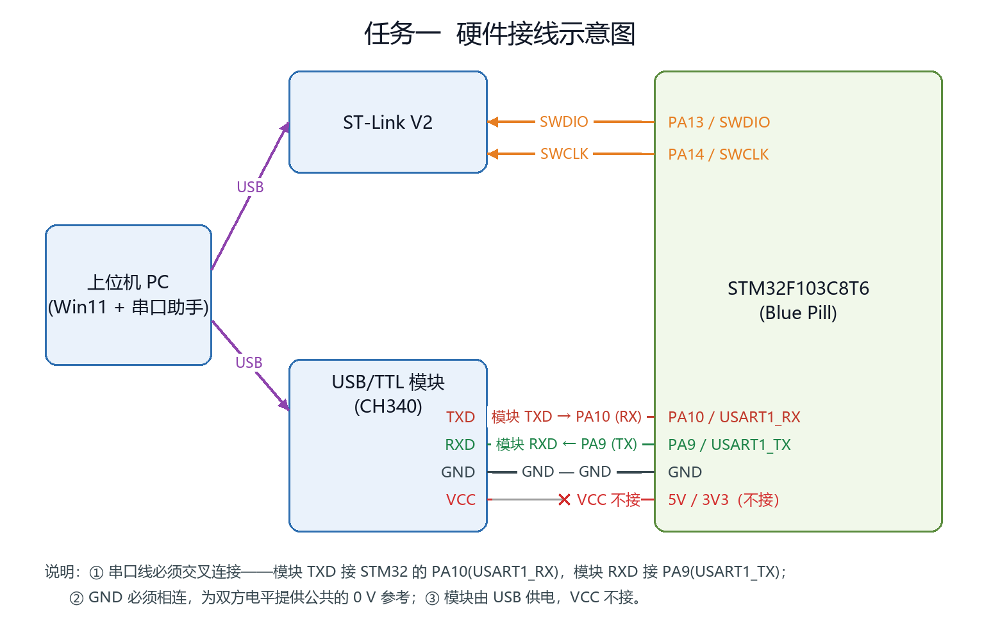

*图 15　任务一硬件接线示意图*

在 Keil 中 Rebuild 编译（0 error、0 warning）后下载到开发板，打开串口助手（本例为纸飞机调试助手，SSCOM 同理）：选择 CH340 对应的 COM 口（图中为 COM14，USB-SERIAL CH340），波特率设为 115200，接收区就会连续出现 `hello windows!`，说明接线与参数配置正确（图 16）。

程序里**没有加任何延时**，STM32 会一帧接一帧地以最快速度发送；在发送后加上 `HAL_Delay(200);` 则每帧间隔 200 ms。两种情况的接收效果对比如图 17、图 18 所示，观察**不加延时的情况下上位机是否出现接收数据丢失、显示不全或界面卡顿**。

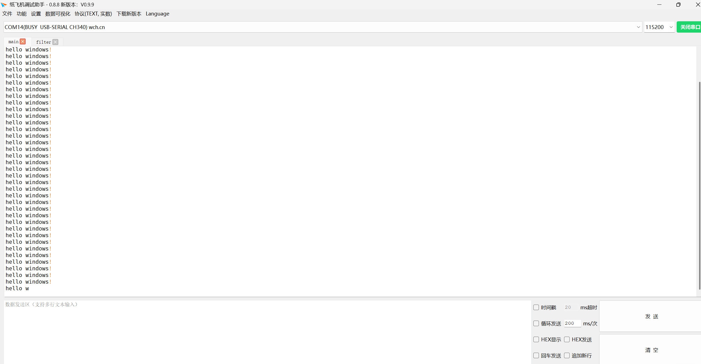

*图 16　串口助手连续接收到 `hello windows!`（COM14、115200、USB-SERIAL CH340）*

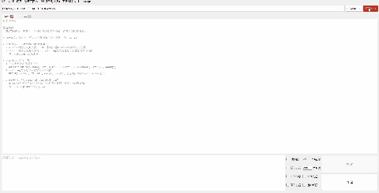

*图 17　不加延时（无间隔）连续发送：实测数据完整、无丢失，仅刷屏很快（动图）*

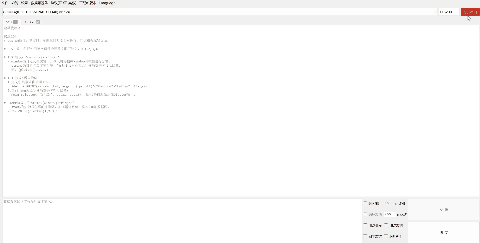

*图 18　发送后加入 `HAL_Delay(200)`，每帧间隔 200 ms（动图）*

**观察结论**：不加延时的情况下**没有出现接收数据丢失**，接收内容完整，只是帧与帧之间没有间隔、串口助手刷屏非常快，不便阅读（图 17）；加上 `HAL_Delay(200)` 后每帧间隔 200 ms，可以逐行清楚地观察（图 18）。

最后把 `my_main.c` 换成 5.3 第（4）部分的代码，重新编译下载。在串口助手中发送字符 `#`，STM32 立即停止发送；再发送 `*`，立即恢复发送（图 19）。

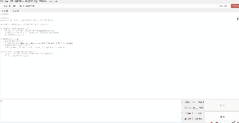

*图 19　发送 `#` 暂停发送、发送 `*` 恢复发送（动图）*

## 六、任务二　串口的中断方式与 DMA 方式

接线与任务一相同（图 15）。

### 6.1 任务二(1)　采用串口中断方式

**（1）使能 USART1 中断**

Connectivity → USART1 → **NVIC Settings**，勾选 **USART1 global interrupt**（图 20）。

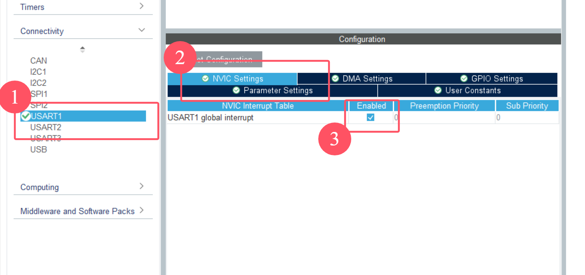

*图 20　NVIC 中使能 USART1 global interrupt*

**（2）修改 my_main.c**

接收改用**逐字节接收中断**（`HAL_UART_Receive_IT`），在接收完成回调 `HAL_UART_RxCpltCallback` 中处理 `#`/`*` 并**重新启动下一次接收**（否则只能收到一个字节）；发送改用**中断发送**（`HAL_UART_Transmit_IT`）。

```c
#include "my_main.h"

char uart_tx_data[30];
uint8_t rx_byte;
uint8_t uart_flag = 1;

void setup(void)
{
	// 启动单字节接收中断 
	HAL_UART_Receive_IT(&huart1, &rx_byte, 1);
}

void loop(void)
{
	if(uart_flag == 1)
	{
		sprintf(uart_tx_data,"hello windows!\r\n");
		HAL_UART_Transmit_IT(&huart1,(uint8_t *)uart_tx_data,(uint16_t)strlen(uart_tx_data));
		HAL_Delay(200);
	}
}


void HAL_UART_RxCpltCallback(UART_HandleTypeDef *huart)
{
	if(huart->Instance == USART1)
	{
		if(rx_byte == '#')
			uart_flag = 0;      // 暂停发送
		else if(rx_byte == '*')
			uart_flag = 1;      // 恢复发送

		HAL_UART_Receive_IT(&huart1, &rx_byte, 1);   
	}
}
```

下载后现象与任务一(2) 相同：默认连续发送 `hello windows!`，发送 `#` 暂停、发送 `*` 恢复。

### 6.2 任务二(2)　采用串口 DMA 方式连续发送

**（1）添加 DMA 请求**

Connectivity → USART1 → **DMA Settings** → 点 **Add**（图 22），DMA Request 选 **USART1_TX**（通道自动分配为 **DMA1 Channel 4**），Direction = Memory To Peripheral，Mode = **Normal**，Increment Address 只勾 Memory，Data Width 均为 Byte（图 23）。

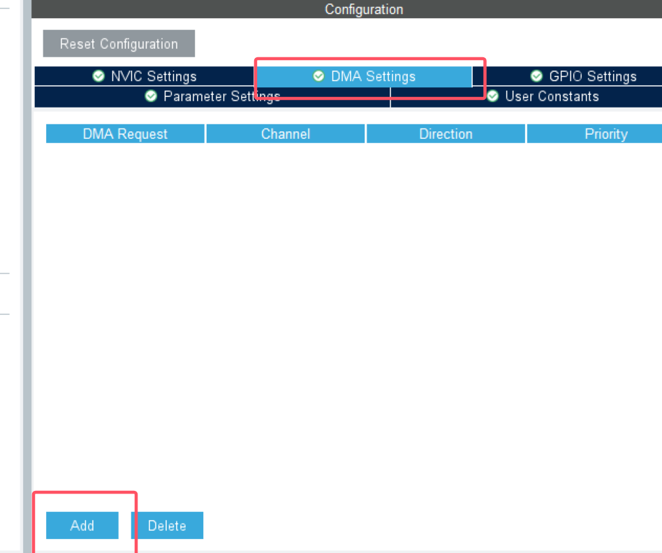

*图 22　USART1 的 DMA Settings 页，点击 Add 添加 DMA 请求*

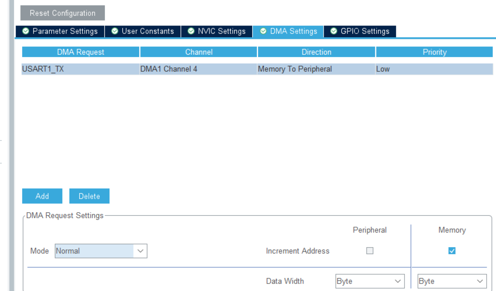

*图 23　DMA 请求参数：USART1_TX、DMA1 Channel 4、Memory To Peripheral、Normal*

**（2）使能 DMA 通道中断**

在 NVIC Settings 中确认 **DMA1 channel4 global interrupt** 已勾选（图 24）。DMA 搬完一帧后由该中断通知 HAL，而整帧真正发送完毕还要等 USART1 的 TC 中断，所以**两个中断都要打开**。

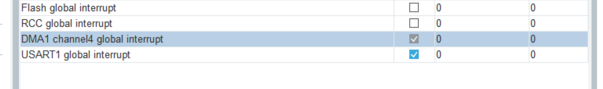

*图 24　DMA1 Channel 4 全局中断已使能*

**（3）修改 my_main.c**

程序只需把发送函数换成 `HAL_UART_Transmit_DMA`：

```c
#include "my_main.h"

char uart_tx_data[] = "hello windows!\r\n";

uint8_t rx_byte;
uint8_t uart_flag = 1;

void setup(void)
{
	HAL_UART_Receive_IT(&huart1, &rx_byte, 1);
}

void loop(void)
{
	if(uart_flag == 1)
	{
		HAL_UART_Transmit_DMA(&huart1,(uint8_t *)uart_tx_data,(uint16_t)strlen(uart_tx_data));
	}
}

void HAL_UART_RxCpltCallback(UART_HandleTypeDef *huart)
{
	if(huart->Instance == USART1)
	{
		if(rx_byte == '#')
			uart_flag = 0;
		else if(rx_byte == '*')
			uart_flag = 1;

		HAL_UART_Receive_IT(&huart1, &rx_byte, 1);
	}
}
```

DMA 方式的要点：发送只登记数据地址和长度就返回，字节搬运由 DMA 硬件完成；主循环反复调用该函数，忙时 HAL 返回 `HAL_BUSY`（不影响状态），不忙就启动下一帧，因此帧与帧之间几乎无缝，形成真正的连续发送，CPU 全程不参与搬运。现象：串口助手收到连续不断的数据流。

## 七、任务三　用 Keil 软件仿真逻辑分析仪观察串口波形

在没有示波器的条件下，使用 Keil MDK 自带的**软件仿真**功能配合**逻辑分析仪**，观察任务二(1)（串口中断方式）的串口输出波形，分析时序状态并计算实际波特率。

### 7.1 仿真环境配置

1. Options for Target → **Debug**，选择 **Use Simulator**；核对 Dialog DLL = **DARMSTM.DLL**、Parameter = **-pSTM32F103C8**并勾选 Run to main()（图 26）。
2. 重新编译（Rebuild）后按 **Ctrl+F5** 进入调试，程序停在 `main()`。
3. 说明：Target 页的 **Xtal (MHz)** 显示为 `<undefined>`，这是 MDK 5.36 之后版本不再开放该项编辑所致，不影响仿真（图 27）。

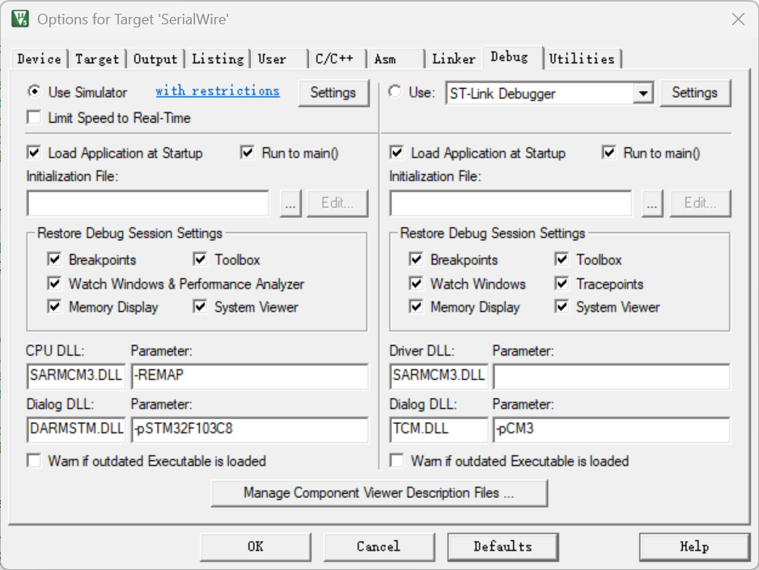

*图 26　Debug 选项卡选择 Use Simulator，Dialog DLL = DARMSTM.DLL、Parameter = -pSTM32F103C8*

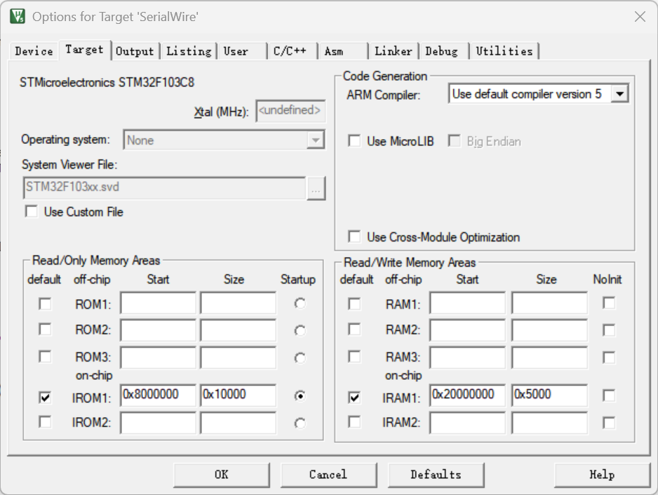

*图 27　Target 页（Xtal 显示 undefined）*

### 7.2 添加观测信号

View → Analysis Windows → **Logic Analyzer** → **Setup…**，添加两个信号（图 28、29）：

- `USART1_SR`：Display Type = **Bit**，And Mask = `0x80`，Shift Right = `7`，即只显示状态寄存器的 **TXE** 位（发送数据寄存器空标志）；
- `USART1_DR`：Display Type = **State**，勾选 Hexadecimal Display，用于读出写入数据寄存器的字节值。

需要说明的是：Keil 的 STM32 软件仿真模型只模拟外设寄存器的行为，**不模拟引脚的实际电平**（实测 `PORTA.9`、`GPIOA_IDR.9` 恒为 0），因此这里通过 USART 状态寄存器间接观察串口的发送时序。

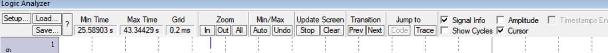

*图 28　逻辑分析仪工具栏（Min/Max Time、Grid、Zoom、Cursor）*

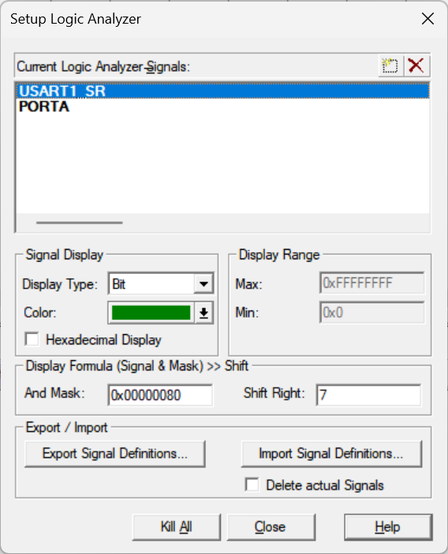

*图 29　USART1_SR 的掩码设置（0x80 / 7，观察 TXE 位）*

### 7.3 波形观测与游标测量

运行（F5）一段时间后停止，可以看到：串口空闲时 TXE = 1；每发送一帧出现 **16 个等间隔的 TXE 脉冲**，一个脉冲对应一个字节发送完成（图 30）。

用逻辑分析仪的游标测量（红线为参考点 Reference Point，蓝线为鼠标位置 Mouse Pos，面板中给出两者的时间差 Delta）：

- 相邻两个 TXE 脉冲（1 个字节 = 10 个比特）：Δ = **87.65278 µs**（图 31）；
- 第 1 个到第 15 个脉冲（14 个字节 = 140 个比特）：Δ = **1.229875 ms**（图 32），折算每字节 87.848 µs；
- 另一次测量（帧首到第 15 个字节写入）：1.318194 ms ÷ 15 = 87.880 µs。

三次结果接近，取平均可得**字节周期 ≈ 87.79 µs**，波动小于 0.3%，说明发送时序稳定。

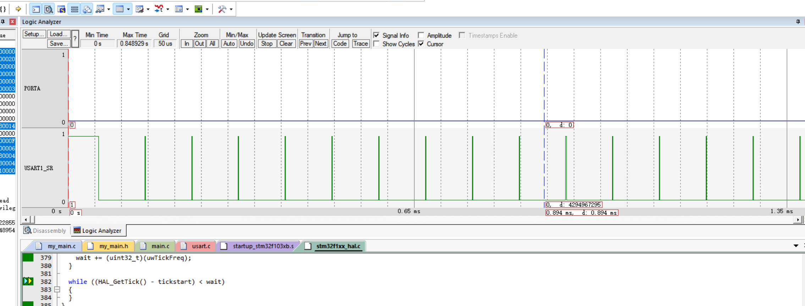

*图 30　一帧内 16 个等间隔的 TXE 脉冲*

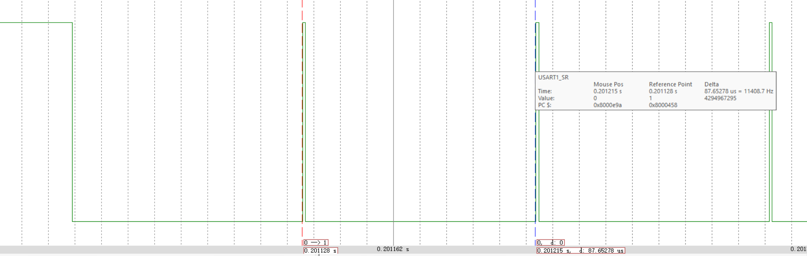

*图 31　游标测量相邻两个 TXE 脉冲：Δ = 87.65278 µs*

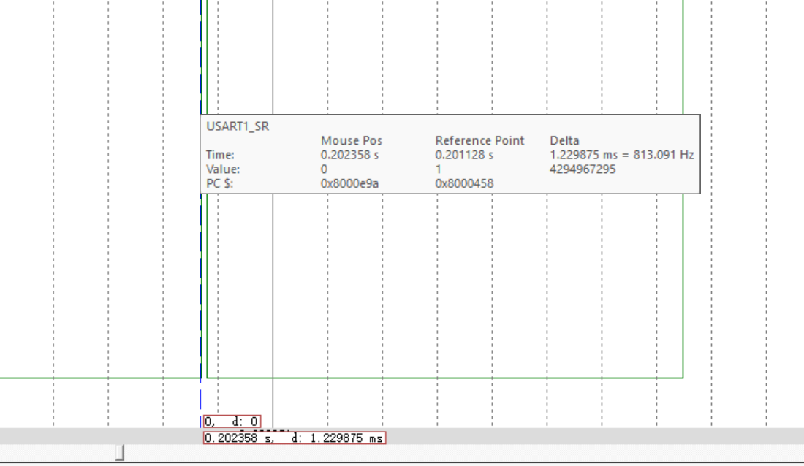

*图 32　游标跨 14 个字节：Δ = 1.229875 ms*

### 7.4 实际波特率计算

**（1）由波形计算**

TXE 的间隔 = 字节传输时间 + 中断响应时间。任务二(1) 采用中断发送，TXE 置位（DR 变空）后要等 CPU 进入中断、执行 HAL 中断服务程序把下一个字节写进 DR，这段空转也会被计入间隔：

```
实测字节周期 87.79 µs − 理论字节时间 86.81 µs = 0.99 µs
0.99 µs × 72 MHz ≈ 71 个 CPU 周期
```

与 Cortex-M3 中断响应加 HAL 中断服务程序的耗时相符。扣除该开销后：

```
比特宽度 = 86.81 µs ÷ 10 = 8.681 µs
实际波特率 = 1 ÷ 8.681 µs ≈ 115 200 bps
```

**（2）由寄存器计算（精确值）**

调试状态下 Peripherals → System View → **USART1**，读得 **BRR = 0x271 = 625**（图 35）：

```
USARTDIV = 625 ÷ 16 = 39.0625
波特率 = f_PCLK2 ÷ (16 × USARTDIV) = 72 000 000 ÷ (16 × 39.0625) = 115 200 bps
```

两种方法结果一致：**实际波特率为 115 200 bps，与设定值相同，误差 0%**。

**（3）时序状态检查**

同一次观测中读到的寄存器值（图 35）：

- SR = **0x000000C0**：TXE = 1、TC = 1，说明一帧发送完毕、发送数据寄存器为空；
- CR1 = **0x0000202C**：UE = 1（USART 使能）、TE = 1（发送使能）、RE = 1（接收使能），PCE = 0（无校验）、M = 0（8 位数据）；
- CR2 = **0x00000000**：1 位停止位。

与 115200-8-N-1 的设定完全一致，说明时序状态正确。

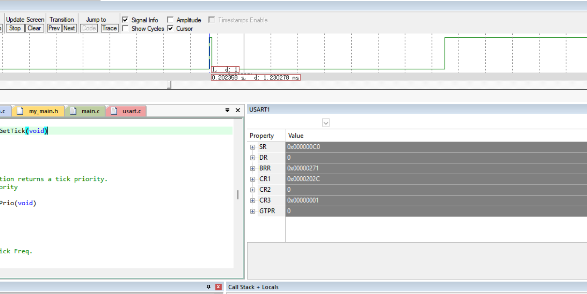

*图 35　USART1 寄存器窗口（BRR = 0x271、SR = 0xC0、CR1 = 0x202C、CR2 = 0x0）*

### 7.5 发送内容解析

`USART1_DR` 的 State 波形呈 16 级阶梯，每一级对应写入 DR 的一个字节，逐级读出即可还原发送内容（图 34）：

```
0x68 0x65 0x6C 0x6C 0x6F 0x20 0x77 0x69 0x6E 0x64 0x6F 0x77 0x73 0x21 0x0D 0x0A
 h    e    l    l    o   空格  w    i    n    d    o    w    s    !   \r   \n
```

即 **"hello windows!\r\n"**，与程序中发送的字符串完全一致，字节数 16 也与 TXE 的 16 个脉冲一一对应。

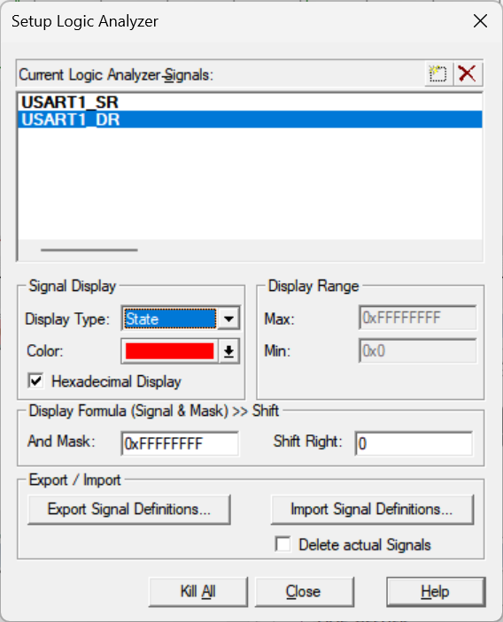

*图 33　USART1_DR 的 State 显示设置*

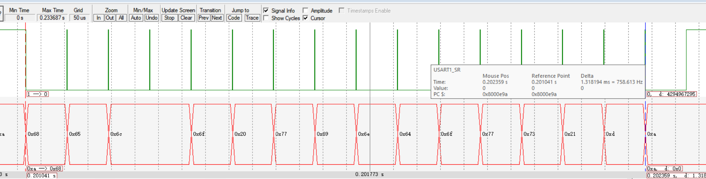

*图 34　USART1_DR 阶梯波形，解出 16 个字节*

### 7.6 结论

1. 串口输出时序状态正确：空闲时 TXE = 1，一帧 16 个字节对应 16 个等间隔的 TXE 脉冲，字节间隔一致（波动 < 0.3%），发送结束后 TC = 1；
2. 实际波特率为 **115 200 bps**，与设定的 115200-8-N-1 一致，误差 0%（BRR = 0x271，USARTDIV = 39.0625）；
3. 波形法测得的字节周期比理论值大 0.99 µs，原因是 TXE 间隔包含了约 71 个 CPU 周期的中断响应开销，属于测量方法的固有偏差，不是波特率设置错误；
4. 由 `USART1_DR` 波形解出的发送内容为 "hello windows!\r\n"，与程序发送的内容一致。

---

## 八、实验体会

这次实验做下来，最大的感受是"串口"比我原先想的要复杂。以前我以为串口就是配好波特率、把字符串发出去，做完基础1 才知道里面其实叠着三层东西：数据怎么组织（帧格式）、以多快的速率发（波特率）、用什么样的电气方式传（TTL / RS-232 / RS-485）。这三层彼此独立，改波特率不影响帧格式，换电平标准也不影响协议本身。想明白这一点，再看 RS-485 用两根差分线就能传一千多米、而 TTL 接一米都要小心，就不觉得奇怪了。

基础2 里拔掉 GND 的那一下给我的印象最深：接上一切正常，拔掉全是乱码。书上那句"单端信号必须共地"到那一刻才算真的看懂了——逻辑电平是相对各自系统的地而言的，双方没有共同的 0 V 参考，接收端根本判断不了高低。反过来，VCC 不接却完全不影响传输，也让我明白地线的作用是给信号提供参考，而不是供电。

任务一、任务二做的是同一件事，实现方式却从轮询换到中断、再换到 DMA。写代码时感觉差别不大，无非换了几个函数名，可用逻辑分析仪的游标一量就看出了门道：轮询和中断发送时，TXE 的间隔比理论的一个字节时间多出约 1 µs，这 1 µs 正是 CPU 被叫去处理中断的代价；DMA 方式下 CPU 只在开始和结束时露个面，搬运全交给硬件。也就是说，这几种方式的差别不在波形上，而在于 CPU 被占用了多少。

另一个收获是学会了"先算再测"。传文件之前我先按公式算出 21.72 s，实测 22 s，只差 1.3%；任务三也没有停在"看起来是 115200"，而是用 BRR = 0x271 反推，得出误差 0%。有了理论值做参照，量出来的数字才知道是对是错。当然坑也踩了不少：接收中断的回调里忘了重新调用接收函数，结果只能收到第一个字符；DMA 那次初始化顺序不对，一个字节都发不出去；用 Keil 软件仿真时 Debug 页只写了通用的 `-pCM3`，逻辑分析仪死活认不出 STM32 的寄存器，改成具体的 `-pSTM32F103C8` 才好。这些问题最后都是先把原理想清楚（谁给谁提供时钟、谁在什么时候被调用）再动手解决的——先想后改，确实比反复试要快。
